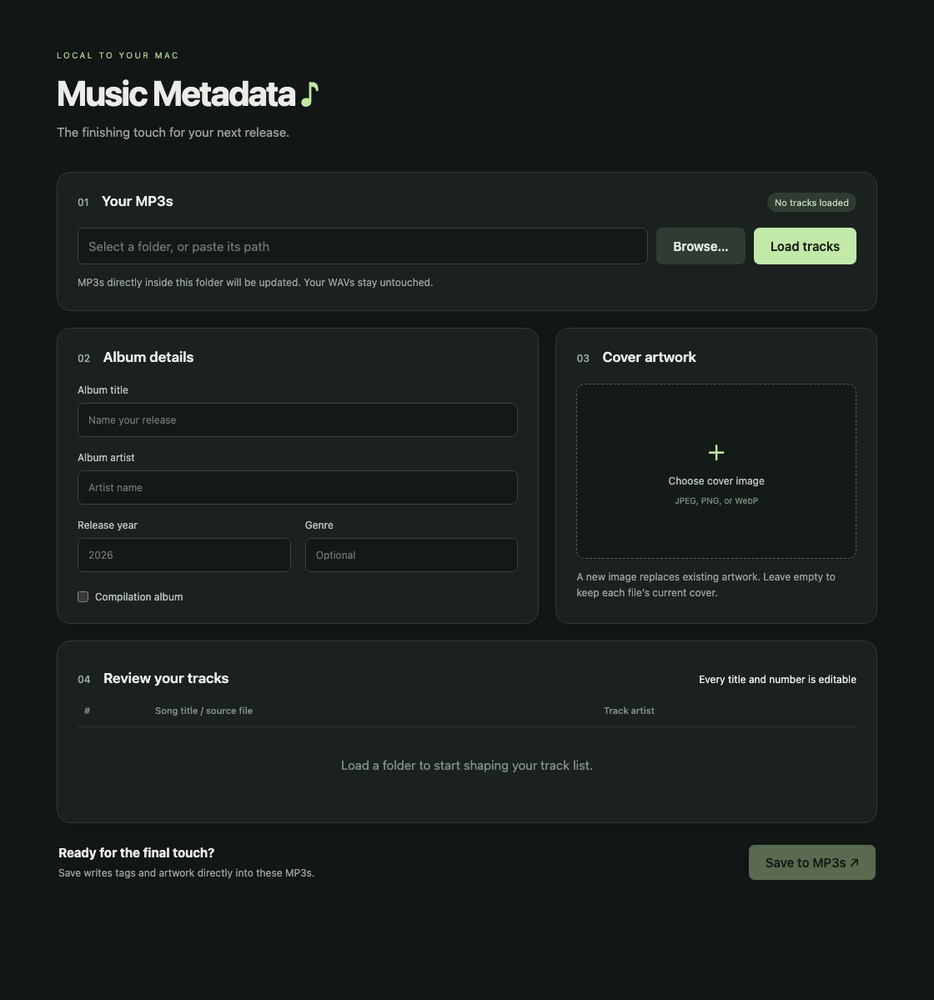

# Music Metadata

A local Mac tool for embedding album details and cover artwork directly into MP3 files.

I built this because editing songs in Apple Music wasn’t updating my original MP3s. My WAVs are the masters; the MP3s are the files I send out.

This is a personal tool I’m sharing as it stands. If it’s useful, take it. If you want something different, fork it and have your agents, or yourself, make it work the way you want. There’s no promise of ongoing support or a release schedule. You don’t need to wait on me to change your copy.



## What it does today

- Loads MP3s directly from a selected folder, using a Mac folder picker or a pasted path. Subfolders and symbolic links are skipped.
- Reads existing tags and suggests editable titles and track numbers from filenames when tags are missing. `01-Crazy.mp3` becomes track 1, “Crazy”; `03-4thWave.mp3` becomes track 3, “4th Wave.”
- Sets album title, album artist, release year, optional genre, and compilation status. Each song has its own editable artist credit.
- Embeds JPEG, PNG, or WebP cover images as JPEG, with a maximum dimension of 2000 pixels. Without a selected image, each MP3 keeps its existing cover.
- Writes ID3v2.3 tags without re-encoding audio or renaming files. WAV files stay untouched.

**Saving modifies the selected MP3s in place.** Each file is staged and checked before atomic replacement. Results are reported per file; successful saves remain saved if another file fails. There’s no undo history or persistent backup.

## Run it on your Mac

Requires **macOS and Python 3.9 or newer**. This has been used and checked on the owner’s Mac, including checks with Python 3.9.6. Other platforms haven’t been verified; the folder picker and launch/stop scripts use macOS tools. This repository is distributed as source, with no packaged Mac app.

Clone the repository with Git:

```sh
git clone https://github.com/jimmytheghost/music-metadata.git
cd music-metadata
./launch.command
```

Or download and extract the source ZIP from GitHub’s **Code** menu, then double-click **launch.command**. On first launch, it creates a local Python environment and downloads dependencies. Later launches reuse it. The browser opens automatically.

If macOS asks which app should open a `.command` file, select Terminal. If the browser doesn’t open, the address is in `.runtime/url`; startup errors are in `.runtime/server.log`.

Double-click **kill.command** to stop the server. Closing the browser leaves it running. To update a Git checkout, finish saving, stop the server, run `git pull --ff-only`, and launch again. For a ZIP download, stop the old copy before opening a freshly extracted copy.

## Use it

1. Choose a folder or paste its path, then click **Load tracks**.
2. Enter the album title and album artist. Release year and genre can be left blank. Track artists follow the album artist until individually overridden.
3. Edit any song’s number, title, or artist. A blank track artist falls back to the album artist on save. **Compilation album** sets a separate tag and doesn’t control artist overrides.
4. Optionally choose a cover image. A new image replaces existing embedded artwork in all loaded MP3s.
5. Review the details, click **Save to MP3s**, and check the results.

Loading tracks keeps entered album details, selected artwork, and your compilation choice. Reloading the same folder also keeps track edits matched by filename. Loading a different folder replaces the track list while keeping the album form.

## Where it’s at

This handles one album and one browser session at a time. Refreshing the page clears unsaved form changes; restarting the server clears its loaded folder. Music apps may need to re-import previously cached files to show updated tags.

The server listens only on `127.0.0.1` at an automatically selected port. Tagging and artwork processing stay on your Mac, with no account, AI, external tagging service, or telemetry. Dependency installation needs internet access.

Saved fields include album, title, artist, album artist, track number/total, release year, genre, disc 1/1, compilation status, and cover artwork. The scope is MP3 tagging; other audio formats, pasted track lists, and native app packaging aren’t implemented.

## Make it yours

Start with [AGENTS.md](AGENTS.md) for the behavior to preserve and the project’s working conventions.

- [metadata.py](metadata.py): filename suggestions, image conversion, and ID3 writes.
- [app.py](app.py): local server, folder loading, and save validation.
- [static/app.js](static/app.js): form state and per-track artist inheritance.
- [templates/index.html](templates/index.html) and [static/style.css](static/style.css): interface and layout.
- [tests/test_metadata.py](tests/test_metadata.py): integration checks using generated MP3s.

For development and verification:

```sh
python3 -m venv .venv
.venv/bin/python -m pip install -r requirements-dev.txt
.venv/bin/python -m unittest discover -s tests -v
node --check static/app.js
zsh -n launch.command kill.command
git diff --check
```

Node.js is only needed for the JavaScript syntax check. Tests use the development-only LAME encoder to generate temporary audio. Use generated files for testing rather than your music collection.

## License

The code is [MIT licensed](LICENSE). You can use, copy, modify, and redistribute it under those terms; it comes with no warranty. Your music and artwork remain yours, and the code license grants no rights to third-party music or images. Dependencies retain their own licenses.
